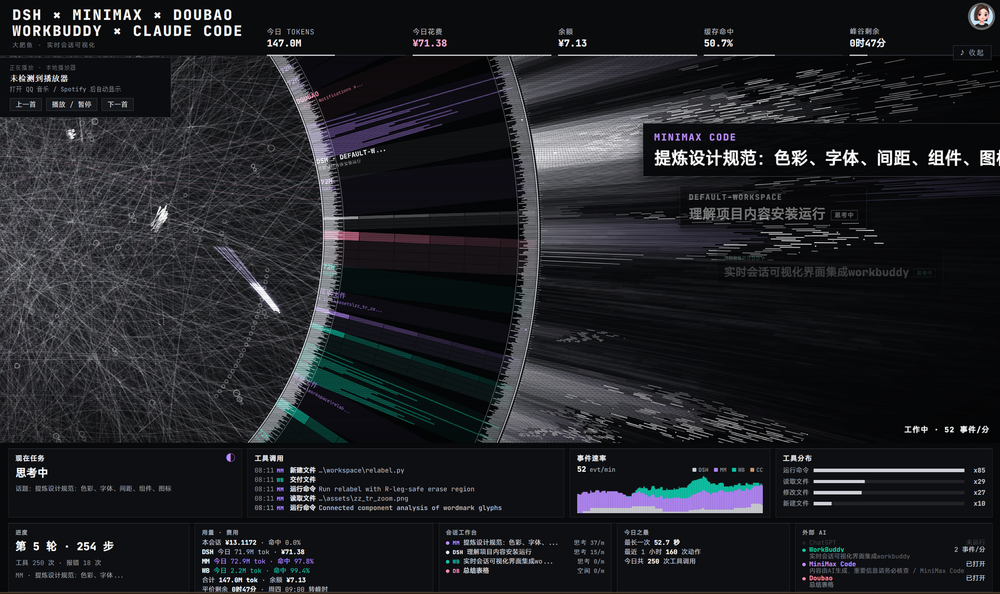
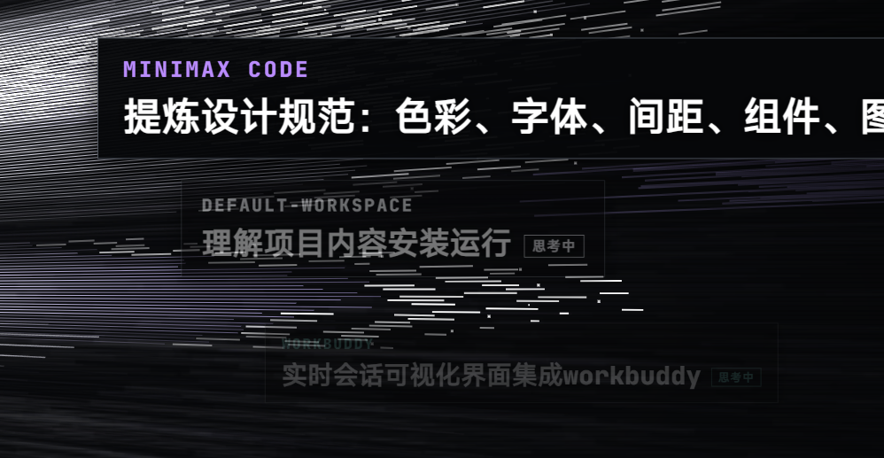
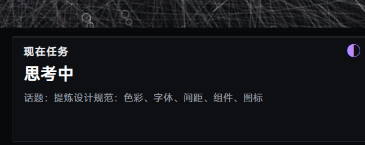

# HALOFLUX Live Wallpaper

> Turns **real DSH session data** into a living desktop wallpaper: the ring spins with event rate, light beams burst on every tool call, and panels show what each AI platform is doing right now. This plugin **supervises the data bridge** — start, health-check, one-click toggle.



*Five AI platforms working at once: title cards on the right of the ring stack by activity (the most recent floats in front, the rest shrink and dim), while the bottom ticker shows every platform's task in parallel.*

---

## What this plugin does

It is the **butler for the data service**, not the wallpaper itself. The visuals and session parsing live in [dsh-hud-haloflux-live2](https://github.com/b1ub1u/dsh-hud-haloflux-live2).

| This plugin | The wallpaper project |
| :--- | :--- |
| Start / stop `dsh-hud/server.mjs` (`127.0.0.1:7788`) | Ring animation, panel rendering, Lively injection |
| HTTP `/stats` health probe (asks "does it answer", not "is a process alive") | 5 AI-platform session parsing, SSE streaming |
| Bounded retries after a crash (8 s backoff, max 5) | Title-card stacking, task ticker |
| Reaps the child on DSH exit — no orphan holding the port | Path redaction, usage accounting |

## Two visual details

**Title-card stacking** — one floating card per active platform; whoever acted most recently comes to the front (full brightness, full size), the rest shrink, offset and dim by depth:



*MiniMax Code (front, full brightness) → DSH / DEFAULT-WORKSPACE (mid, thinking) → WorkBuddy (back, dimmest).*

**Task ticker** — the bottom panel lists every platform's live task, the first row bright and each subsequent row dimmer, with soft top/bottom fade and seamless looping:



*MiniMax's current topic, with other platforms scrolling through the band.*

---

## Install

### 1. Install the wallpaper first

```powershell
git clone https://github.com/b1ub1u/dsh-hud-haloflux-live2.git
powershell -NoProfile -ExecutionPolicy Bypass -File dsh-hud-haloflux\dsh-hud\install.ps1
```

### 2. Install this plugin

**No npm account required.** Three equivalent ways:

**A · Clone from GitHub, install locally (recommended)**

```powershell
git clone https://github.com/b1ub1u/dsh-plugin-haloflux.git
dsh plugin --profile desktop add "D:\path\to\dsh-plugin-haloflux"
```

**B · From the DSH UI**

DSH → Settings → Plugins → Install from local directory → pick the cloned folder.

**C · npm (only after publishing)**

```powershell
dsh plugin --profile desktop add dsh-plugin-haloflux
```

Restart DSH; a "HALOFLUX Live Wallpaper" section appears in Settings.

> All three are equivalent: DSH only reads `dsh.bundle.patch` and `dsh.client` from `package.json`, so where the package comes from does not affect activation. Local installs use pnpm link; `git pull` then restart to upgrade.

---

## Configuration

| Key | Default | Meaning |
| :--- | :--- | :--- |
| `projectDir` | auto-detect | Wallpaper project root (contains `dsh-hud/server.mjs`) |
| `port` | `7788` | Data service port |
| `autoStart` | `true` | Start the bridge when DSH starts |

Auto-detect order: `~/.dsh/haloflux` → `~/Documents/deepseek-harness/default-workspace/dsh-hud-haloflux` → local dev path. When nothing is found the panel says so instead of failing silently.

## HTTP surface

| Route | Purpose |
| :--- | :--- |
| `GET /plugins/dsh-plugin-haloflux/status` | State, port, project dir, pid, bridge stats, last error |
| `GET /plugins/dsh-plugin-haloflux/start` | Start the data service |
| `GET /plugins/dsh-plugin-haloflux/stop` | Stop the service this plugin supervises |

```json
{
  "state": "running",
  "port": 7788,
  "projectDir": "...\\dsh-hud-haloflux",
  "managed": false,
  "stats": { "sessions": 14, "clients": 2, "rssMB": 84 }
}
```

---

## Design decisions

- **Never kills someone else's process**: if something already answers on 7788, the plugin adopts it (`adopted`) instead of killing the bridge you started by hand.
- **Fails soft**: a missing checkout, a taken port or a dead spawn only writes a reason into the panel; the plugin itself never throws or unloads.
- **Does not touch session logs**: reading `~/.dsh/sessions` belongs to the bridge; this plugin does not reimplement it.
- **Backoff**: no restart within 8 s; automatic retries stop after 5 consecutive failures, so a crash loop cannot spin.
- **No silent system changes**: installing Lively stays in the project's `install.ps1`; the plugin only owns the service lifecycle.

## License

- This plugin: **MIT**
- Wallpaper visuals: HALOFLUX by [Ryder191](https://github.com/Ryder191/haloflux), **PolyForm Noncommercial (no commercial use)**

## Related

- Wallpaper project: [dsh-hud-haloflux-live2](https://github.com/b1ub1u/dsh-hud-haloflux-live2)
- Visual core: [Ryder191/haloflux](https://github.com/Ryder191/haloflux)
- Wallpaper host: [Lively Wallpaper](https://github.com/rocksdanister/lively)
