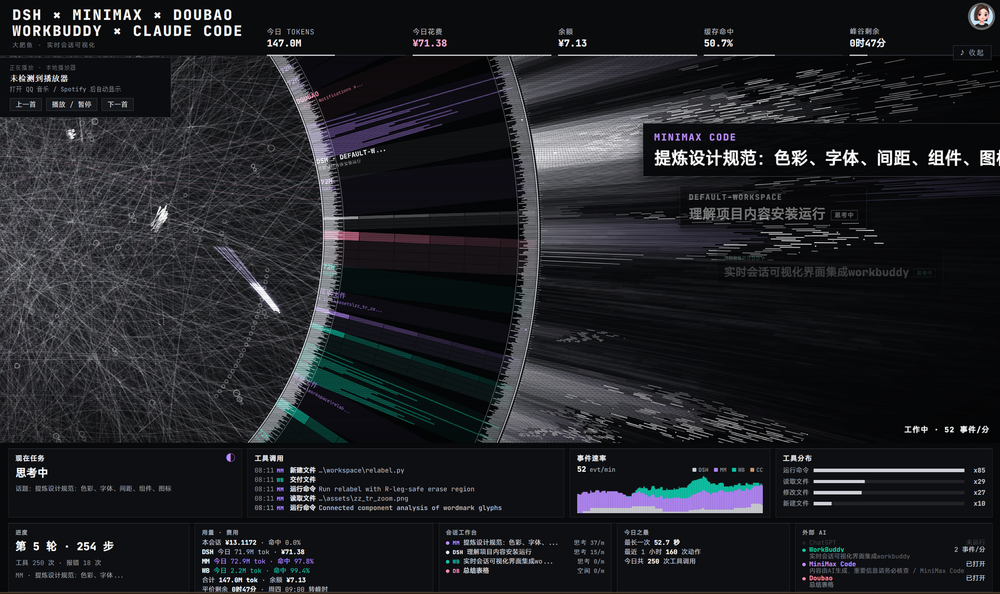

# HALOFLUX 实时壁纸

> 把 **DSH 的真实会话数据**接成一张会呼吸的桌面壁纸：环带随事件转速、光束随工具调用爆发、面板显示每个 AI 平台此刻在干什么。本插件负责**托管数据服务**——启动、健康检查、一键启停。



*五个 AI 平台同时干活：圆环右侧的标题卡片按活跃度层叠（最近操作的浮在最前、其余逐层缩小压暗），底部「现在任务」滚动带并行显示各平台任务。*

---

## 这个插件做什么

它是**数据服务的管家**，不是壁纸本身。壁纸的视觉与解析在 [dsh-hud-haloflux-live2](https://github.com/b1ub1u/dsh-hud-haloflux-live2) 项目里。

| 插件负责 | 壁纸项目负责 |
| :--- | :--- |
| 启动 / 停止 `dsh-hud/server.mjs`（`127.0.0.1:7788`） | 环带动画、面板渲染、Lively 注入 |
| HTTP `/stats` 健康探测（探「能否应答」，不是猜进程） | 5 个 AI 平台会话解析、SSE 推送 |
| 崩溃后受限重试（8 秒退避，最多 5 次） | 多卡标题堆叠、现在任务滚动带 |
| DSH 退出时回收子进程，不留孤儿占端口 | 路径脱敏、用量统计 |

## 两个视觉细节

**多卡标题堆叠** —— 每个活跃平台一张浮动标题卡，谁最近操作谁浮最前（全亮原尺寸），其余按活跃度逐层缩小、平移、压暗：


*MiniMax Code（最前·全亮）→ DSH / DEFAULT-WORKSPACE（中景·思考中）→ WorkBuddy（背景·最暗）。*

**现在任务渐变滚动带** —— 底部面板并行显示各平台实时任务，第一行全亮、往下逐层变暗，上下边缘渐隐、无缝循环滚动：


*「现在任务」显示 MiniMax 正在思考的话题，多平台任务在带内滚动轮播。*

---

## 安装

### 1. 先装壁纸本体

```powershell
git clone https://github.com/b1ub1u/dsh-hud-haloflux-live2.git
powershell -NoProfile -ExecutionPolicy Bypass -File dsh-hud-haloflux\dsh-hud\install.ps1
```

### 2. 再装本插件

**不需要 npm 账号**，三种方式任选：

**方式 A · 从 GitHub clone 后本地安装（推荐）**

```powershell
git clone https://github.com/b1ub1u/dsh-plugin-haloflux.git
dsh plugin --profile desktop add "D:\path\to\dsh-plugin-haloflux"
```

**方式 B · DSH 界面里装**

DSH → 设置 → 插件 → 从本地目录安装 → 选中 clone 下来的目录。

**方式 C · npm（发布到 npm 后才可用）**

```powershell
dsh plugin --profile desktop add dsh-plugin-haloflux
```

装完重启 DSH，设置里出现「HALOFLUX 实时壁纸」一节。

> 三种方式等价：DSH 只认 `package.json` 里的 `dsh.bundle.patch` 与 `dsh.client` 声明，包从哪来不影响激活。本地安装走 pnpm link，升级时 `git pull` 后重启即可。

---

## 配置

| 键 | 默认 | 说明 |
| :--- | :--- | :--- |
| `projectDir` | 自动探测 | 壁纸项目根目录（含 `dsh-hud/server.mjs`） |
| `port` | `7788` | 数据服务端口 |
| `autoStart` | `true` | DSH 启动时自动拉起数据服务 |

自动探测顺序：`~/.dsh/haloflux` → `~/Documents/deepseek-harness/default-workspace/dsh-hud-haloflux` → 本机开发路径。找不到时面板会明确提示，不会静默失败。

## 对外接口

| 路由 | 作用 |
| :--- | :--- |
| `GET /plugins/dsh-plugin-haloflux/status` | 状态、端口、项目目录、pid、桥接统计、最近错误 |
| `GET /plugins/dsh-plugin-haloflux/start` | 启动数据服务 |
| `GET /plugins/dsh-plugin-haloflux/stop` | 停止由本插件托管的服务 |

实际返回：

```json
{
  "state": "running",
  "port": 7788,
  "projectDir": "...\\dsh-hud-haloflux",
  "managed": false,
  "stats": { "sessions": 14, "clients": 2, "rssMB": 84 }
}
```

---

## 设计取舍

- **不重启别人的进程**：若 7788 上已有服务应答，插件直接采纳（`adopted`），不会杀掉你手动启动的进程。
- **失败软着陆**：找不到项目、端口被占、子进程崩溃，都只把原因写进面板，插件本身不抛错、不卸载。
- **不碰会话日志**：读 `~/.dsh/sessions` 是壁纸桥的职责，插件不重复实现。
- **退避防抖**：8 秒内不重复启动；连续失败 5 次后停止自动重试，避免崩溃循环。
- **不静默改系统**：装 Lively 那类操作留在项目侧 `install.ps1`，插件只负责服务生命周期。

## 许可

- 本插件：**MIT**
- 壁纸视觉：HALOFLUX by [Ryder191](https://github.com/Ryder191/haloflux)，**PolyForm Noncommercial（禁止商业用途）**

## 相关

- 壁纸项目：[dsh-hud-haloflux-live2](https://github.com/b1ub1u/dsh-hud-haloflux-live2)
- 视觉本体：[Ryder191/haloflux](https://github.com/Ryder191/haloflux)
- 壁纸宿主：[Lively Wallpaper](https://github.com/rocksdanister/lively)
